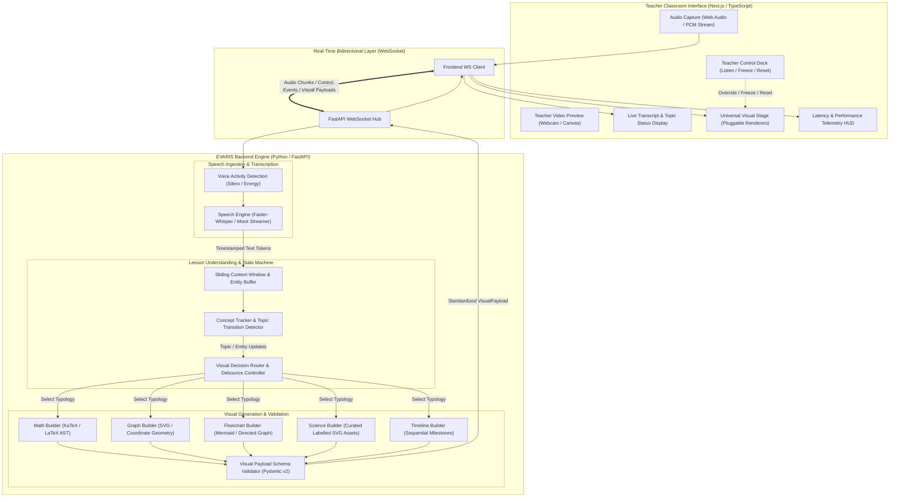

# EVARIS — System Architecture & Phase 0 Specification
**Product Identity:** EVARIS (Every Victory Arrives After Rising In Silence)  
**Tagline:** Intelligence That Makes Learning Visible  
**Category:** AI-Powered Real-Time Visual Teaching Engine  
**Version:** Phase 0 Architecture Document  

---

## 1. Executive Summary & Product Understanding

**EVARIS** is an ambient visual teaching engine designed for online educators. Traditional remote teaching forces teachers into constant cognitive friction: halting natural explanations to search for diagrams, draw whiteboard sketches, fiddle with slide decks, or share screen tabs. At the same time, students struggle to grasp abstract concepts through audio alone.

EVARIS solves this problem by acting as a silent, intelligent visual copilot. It listens to a teacher's spoken explanation in real time, understands the conceptual progression, and automatically surfaces or mutates relevant, verified visual representations (equations, function graphs, system flowcharts, anatomical diagrams, timelines) directly alongside the teacher's video feed.

### Core Distinctions
1. **Ambient & Hands-Free:** The teacher does not manually search for assets, hold objects to the webcam, or configure complex slide transitions.
2. **Deterministic & Factually Grounded:** EVARIS avoids hallucination-prone image generators. It leverages programmatic rendering (KaTeX for mathematics, dynamic SVG for coordinate functions and geometries, Mermaid for flowcharts and architectures, and curated vector schematics for science).
3. **Smart Visual Continuity:** Rather than replacing visuals on every spoken sentence, EVARIS retains the active visual and selectively highlights, mutates, or annotates sub-elements as the explanation deepens.
4. **Universal Subject Engine:** A single reusable cognitive and rendering pipeline capable of supporting Mathematics, Science, Computer Science, History, Economics, and Languages.

---

## 2. Core User Problem & Solution Dynamics

| Dimension | Legacy Online Teaching | EVARIS Paradigm |
| :--- | :--- | :--- |
| **Teacher Workflow** | Fragmented. Constant context switching to find images, switch tabs, or draw sketches. | Natural flow. The teacher simply teaches; the visual layer surfaces contextually in the background. |
| **Visual Freshness** | Pre-packaged static slides or uncurated Google Image searches. | Dynamic, real-time programmatic visual artifacts matched to speech progression. |
| **Visual Stability** | Disorienting screen transitions, visual flickers, or empty screens. | Visual continuity. Graphs mutate smoothly (e.g. highlighting a vertex), reducing cognitive load. |
| **Accuracy** | Image generators hallucinate labels, anatomy, and mathematical formulas. | Deterministic renderers (KaTeX, SVG, dynamic plotting) guarantee mathematical and scientific precision. |
| **Teacher Agency** | Overridden by complex automation or trapped in rigid slide sequences. | Teacher retains total sovereignty: instant Pause, Freeze, Reset, and Manual Override controls. |

---

## 3. End-to-End System Architecture

The following diagram illustrates the unidirectional event loop and processing layers connecting the classroom frontend, audio pipeline, understanding engine, and visual stage:



### Event Lifecycle & Data Contracts

Each message across the WebSocket adheres to a structured event schema:

```json
{
  "event_type": "VISUAL_PAYLOAD",
  "timestamp_ms": 1718500000000,
  "payload": {
    "visual_id": "vis_quad_01",
    "topic": "Quadratic Functions",
    "concept": "Parabola Vertex",
    "typology": "FUNCTION_GRAPH",
    "mode": "UPDATE",
    "continuity_key": "graph_f_x_square",
    "title": "f(x) = x² - 4x + 3",
    "data": {
      "expression": "x^2 - 4*x + 3",
      "domain": [-1, 5],
      "range": [-2, 6],
      "active_features": [
        {
          "id": "vertex",
          "type": "point",
          "coordinates": [2, -1],
          "label": "Vertex (2, -1) [Minimum]",
          "highlight": true
        }
      ]
    },
    "metadata": {
      "confidence": 0.96,
      "subject": "Mathematics",
      "generation_time_ms": 14.2
    }
  }
}
```

---

## 4. Recommended Folder Structure

```
c:\Users\HP\Desktop\EVARIS/
├── backend/
│   ├── app/
│   │   ├── api/                      # REST and WebSocket routing
│   │   │   ├── __init__.py
│   │   │   ├── routes.py             # Healthcheck, metadata, sample lessons
│   │   │   └── ws_endpoints.py       # Live audio & classroom WebSocket handler
│   │   ├── core/                     # Infrastructure, configuration, telemetry
│   │   │   ├── __init__.py
│   │   │   ├── config.py             # Typed settings (Pydantic Settings)
│   │   │   ├── telemetry.py          # Latency timer & performance profiler
│   │   │   └── event_bus.py          # Internal pub/sub event router
│   │   ├── speech/                   # Speech ingestion & transcription
│   │   │   ├── __init__.py
│   │   │   ├── base.py               # Abstract base transcriber
│   │   │   ├── mock_streamer.py      # Sample lesson audio/text emitter for Phase 1
│   │   │   └── whisper_engine.py     # Local Faster-Whisper wrapper (Phase 2)
│   │   ├── understanding/            # Cognitive layer
│   │   │   ├── __init__.py
│   │   │   ├── context_buffer.py     # Sliding sentence accumulator & tokenizer
│   │   │   ├── concept_tracker.py    # Concept transition & state machine
│   │   │   └── decision_engine.py    # Visual necessity & typology selector
│   │   ├── visual/                   # Universal visual generator
│   │   │   ├── __init__.py
│   │   │   ├── models.py             # Pydantic schemas (VisualPayload, Typologies)
│   │   │   ├── asset_catalog.py      # Curated verified SVG assets (Science, CS)
│   │   │   └── builders/             # Deterministic visual artifact generators
│   │   │       ├── __init__.py
│   │   │       ├── math_builder.py
│   │   │       ├── graph_builder.py
│   │   │       ├── flowchart_builder.py
│   │   │       ├── science_builder.py
│   │   │       └── timeline_builder.py
│   │   └── main.py                   # FastAPI initialization & ASGI entrypoint
│   ├── tests/                        # Automated backend tests
│   │   ├── test_decision_engine.py
│   │   ├── test_visual_payloads.py
│   │   └── test_websocket_flow.py
│   ├── requirements.txt              # Strict pinned Python dependencies
│   ├── pyproject.toml                # Project packaging configuration
│   └── .env.example                  # Environment configuration template
├── frontend/
│   ├── public/                       # Static brand assets, fonts, icons
│   ├── src/
│   │   ├── app/                      # Next.js 15 App Router
│   │   │   ├── layout.tsx            # Global brand layout & typography
│   │   │   ├── page.tsx              # EVARIS Classroom Main Stage
│   │   │   └── globals.css           # Design tokens, variables & resets
│   │   ├── components/
│   │   │   ├── classroom/            # Classroom workspace components
│   │   │   │   ├── ClassroomHeader.tsx
│   │   │   │   ├── TeacherVideoPreview.tsx
│   │   │   │   ├── LiveTranscriptBar.tsx
│   │   │   │   ├── TopicStatusBadge.tsx
│   │   │   │   ├── ClassroomControls.tsx
│   │   │   │   └── TelemetryHUD.tsx
│   │   │   └── visual-engine/        # Pluggable universal visual renderers
│   │   │       ├── VisualStage.tsx   # Visual continuity host & transition manager
│   │   │       ├── MathRenderer.tsx  # KaTeX LaTeX renderer
│   │   │       ├── GraphRenderer.tsx # Interactive SVG coordinate & curve renderer
│   │   │       ├── FlowchartRenderer.tsx # Mermaid / SVG graph renderer
│   │   │       ├── ScienceRenderer.tsx   # Verified schematic & labelled SVG renderer
│   │   │       └── TimelineRenderer.tsx  # Interactive milestone timeline
│   │   ├── hooks/                    # Reusable React hooks
│   │   │   ├── useClassroomSocket.ts # WebSocket state, reconnect & message queue
│   │   │   ├── useTeacherMedia.ts    # Camera & microphone permission lifecycle
│   │   │   └── useSampleLesson.ts    # Interactive demo runner hook
│   │   ├── types/                    # Shared TypeScript interfaces
│   │   │   ├── classroom.ts
│   │   │   └── visual.ts
│   │   └── lib/                      # Utilities & helpers
│   │       ├── websocket.ts
│   │       └── formatters.ts
│   ├── package.json
│   ├── tsconfig.json
│   └── next.config.ts
├── docs/                             # Engineering & architectural documentation
│   ├── PHASE_0_SYSTEM_ARCHITECTURE.md
│   └── VISUAL_TYPOLOGY_SPEC.md
└── README.md                         # Project overview, vision, and local setup
```

---

## 5. Technology Stack & Dependencies for Phase 1

### Backend (Python 3.12+)
- **FastAPI (`fastapi==0.115.0`)**: High-performance asynchronous web framework.
- **Uvicorn (`uvicorn[standard]==0.31.0`)**: Lightning-fast ASGI production server.
- **WebSockets (`websockets==13.1`)**: Real-time bidirectional streaming.
- **Pydantic (`pydantic==2.9.2`)**: Strict data modeling, schema validation, and serialization.
- **Pydantic Settings (`pydantic-settings==2.5.2`)**: Typed environment variable configuration.
- **Pytest & HTTPX (`pytest==8.3.3`, `httpx==0.27.2`, `pytest-asyncio==0.24.0`)**: Async unit and integration testing suite.
- **Zero Paid Dependencies:** No OpenRouter, no OpenAI API keys, no external billable cloud services required.

### Frontend (Next.js & TypeScript)
- **Next.js 15 (React 19)**: Modern React framework supporting client components and high-performance hydration.
- **TypeScript**: Strict compile-time type safety matching backend Pydantic models.
- **Vanilla CSS / CSS Modules**: Strict adherence to design tokens, ensuring high-polish commercial aesthetics without relying on heavyweight utility classes.
- **KaTeX (`katex==0.16.11`)**: Client-side zero-latency mathematics and equation rendering.
- **Lucide Icons (`lucide-react`)**: Clean, accessible, lightweight interface iconography.
- **Mermaid / SVG primitives**: Programmatic diagramming and graph layout.

---

## 6. Technical Risks, Assumptions & Mitigations

| Risk / Problem | Impact | Architectural Mitigation |
| :--- | :--- | :--- |
| **Speech Latency & Audio Buffering** | Real-time speech-to-text can introduce 400ms-1500ms lag on CPU. | For Phase 1, build a deterministic **Sample Lesson Runner** that streams realistic timestamped transcripts to validate the entire cognitive and rendering pipeline. Benchmark local Faster-Whisper with Silero VAD in Phase 2 with explicit telemetry timers. |
| **Visual Churn & Flicker** | Generating a new visual on every sentence distracts students and degrades teaching. | Implement a **Visual Decision Hysteresis Engine** with concept continuity keys (`continuity_key`). When the topic persists, the engine emits `mode: "UPDATE"` or `mode: "HIGHLIGHT"`, mutating only specific SVG elements rather than reloading the canvas. |
| **Generative Hallucinations** | Diffusion models frequently generate unreadable equations, incorrect anatomical labels, or misleading charts. | Completely prohibit raw text-to-image models for structural learning. Use **deterministic programmatic renderers** (KaTeX for math, vector SVG coordinates for graphs, Mermaid for flowcharts, verified curated SVGs for anatomy/science). |
| **Microphone & Camera Failures** | Teachers may deny permissions or experience audio hardware drops mid-class. | Implement a resilient **Media Permission & Fallback State Machine**. The UI cleanly informs the teacher, offers a fallback interactive mock avatar preview, and allows full teaching simulation via sample transcripts. |
| **Cross-Platform Host Consistency** | Windows C++ runtimes or CUDA dependencies may fail across varied teacher laptops. | Strict modularization. The backend runs pure Python standard library and FastAPI for Phase 1, making local setup instantaneous without requiring compiled binary wheels or GPU drivers. |

---

## 7. Phase 1 Implementation Checklist

- [ ] **Repository Setup:**
  - Create directory layout (`backend/`, `frontend/`, `docs/`).
  - Create root `README.md` and `.gitignore`.
- [ ] **Backend Foundations:**
  - Setup Python virtual environment and `requirements.txt`.
  - Implement `app/core/config.py` and `app/core/telemetry.py`.
  - Implement Pydantic data schemas in `app/visual/models.py`.
- [ ] **Cognitive & Visual Engine (Phase 1 Logic):**
  - Implement `ContextBuffer` and `ConceptTracker` with multi-subject support.
  - Implement visual builders: Math (KaTeX), Function Graphs (SVG curves), Flowcharts (Mermaid), Timelines, and Scientific Schematics.
  - Implement `MockStreamer` supporting at least 3 distinct subjects:
    1. *Mathematics:* Quadratic functions, vertex highlight, roots.
    2. *Computer Science:* Binary Search tree/flowchart and active search path.
    3. *Science:* Photosynthesis process / plant cell organelle highlight.
- [ ] **WebSocket Communication:**
  - Build FastAPI WebSocket endpoint (`/ws/classroom/{session_id}`).
  - Handle client events: `START_SAMPLE_LESSON`, `PAUSE`, `RESUME`, `RESET`, `MANUAL_STEP`.
- [ ] **Frontend Classroom Workspace:**
  - Initialize Next.js project with TypeScript and Vanilla CSS design tokens.
  - Create dark-mode premium EdTech styling (Inter font, slate glassmorphic surface, crisp typography).
  - Build `ClassroomHeader`, `TeacherVideoPreview` (with webcam access toggle and privacy badge), `LiveTranscriptBar`, and `TopicStatusBadge`.
  - Build `ClassroomControls` (Listen toggle, Pause/Resume, Reset, Subject Picker).
  - Build `TelemetryHUD` (live display of transcript delay, concept decision time, render latency).
- [ ] **Universal Visual Stage & Continuity:**
  - Build `VisualStage` with smooth CSS-based continuity transitions.
  - Implement `MathRenderer`, `GraphRenderer`, `FlowchartRenderer`, and `ScienceRenderer`.
  - Verify that visual element highlights (e.g. graph vertex or flowchart node) animate without remounting the stage.
- [ ] **Verification & Automated Tests:**
  - Write backend pytest tests verifying payload schemas, state machine transitions, and WebSocket events.
  - Test browser responsiveness and accessibility (unique IDs, semantic layout).
  - Document local setup and execution commands.

---

## 8. Local Setup & Testing Commands

### Backend Setup & Test
```powershell
# In backend directory:
python -m venv venv
.\venv\Scripts\Activate.ps1
pip install -r requirements.txt

# Run automated test suite:
pytest -v

# Start development ASGI server:
uvicorn app.main:app --reload --host 127.0.0.1 --port 8000
```

### Frontend Setup & Test
```powershell
# In frontend directory:
npm install

# Start Next.js development server:
npm run dev

# Access classroom in browser at:
# http://localhost:3000
```

---

## 9. Phased Scope Boundaries

| Feature | Phase 1 (Working Prototype) | Phase 2 & Later (Production Evolution) |
| :--- | :---: | :---: |
| **Classroom Interface** | Complete, commercial-grade UI with video preview, controls, transcript bar, and telemetry | Multi-participant layout, breakout stages |
| **Visual Rendering** | Dynamic KaTeX, SVG coordinate curves, Mermaid flowcharts, vector diagrams | 3D WebGL models, interactive student manipulations |
| **Visual Continuity** | Mutation & highlight payloads on existing visuals | Multi-layer canvas morphing & animated parameter sweeps |
| **Input Source** | Interactive Sample Lesson engine + transcript simulation | Live microphone audio streaming via WebSockets |
| **Speech Processing** | Deterministic token streaming & latency profiling | Local Faster-Whisper with Silero VAD |
| **Concept Tracking** | Multi-subject rule & state machine parser | Fine-tuned local SLM / NER semantic parser |
| **Persistence** | In-memory session state | PostgreSQL, Redis cache, S3 asset storage |
| **Commercial Features** | Architecture & data contracts prepared | Tenant auth, billing, LMS/Zoom/Meet plugins, SDK |

---

## 10. Verification of Safety & Non-Destructive Principles

- The workspace was verified as an empty directory prior to file generation.
- No third-party proprietary API keys or external paid dependencies are configured.
- The project adheres strictly to the canonical name **EVARIS** and the tagline **"Intelligence That Makes Learning Visible."**
